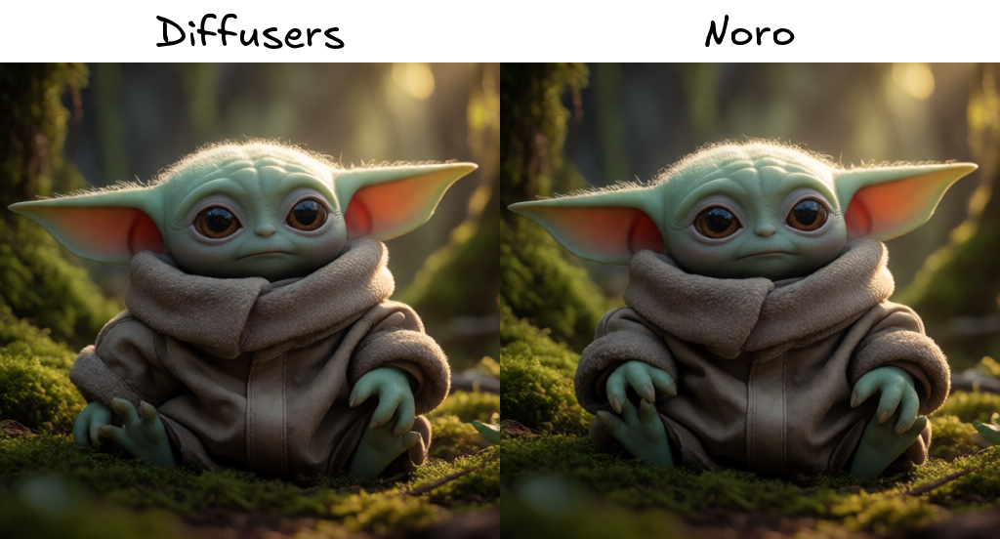

# Noro

Noro is an image and video inference library.

## Install

```sh
uv sync --extra triton
```

For development, include the development tools:

```sh
uv sync --extra triton --extra dev
```


## Generate an image


```python
import torch
from noro import Krea2Pipeline

pipe = Krea2Pipeline.from_pretrained(
    "krea/Krea-2-Turbo",
    backend="triton",  # or diffusers
    compile=True,      # optional; first request compiles the blocks
    torch_dtype=torch.bfloat16,
).to("cuda")

result = pipe(
    "A red fox walking through a snowy pine forest at sunrise",
    height=1024,
    width=1024,
    num_inference_steps=8,
    guidance_scale=0.0,
)
result.images[0].save("fox.png")
```


## Diffusers and Noro output

same prompt, seed, resolution, and inference settings on both backends (512×512, 8 steps, guidance 0):




## Full inference benchmarks

Modal NVIDIA A100-SXM4-80GB, BF16, Krea-2 Turbo, 8 steps, guidance 0, seed 0.
Diffusers runs eagerly; Noro uses `backend="triton", compile=True`.
Both use the same checkpoint weights and GPU, alternating execution order.
Times are means of five full requests per size, including prompt encoding,
denoising, VAE decoding, and PIL output. Two warmup requests per backend and size
are excluded, along with model loading and compilation.

| Resolution | Image tokens | Diffusers | Noro (compiled) | Latency reduction |
|---:|---:|---:|---:|---:|
| 128×128 | 64 | 0.920 s | 0.707 s | 23.2% |
| 256×256 | 256 | 1.054 s | 0.815 s | 22.7% |
| 384×384 | 576 | 1.379 s | 1.078 s | 21.8% |
| 512×512 | 1,024 | 1.901 s | 1.513 s | 20.4% |
| 640×640 | 1,600 | 2.602 s | 2.100 s | 19.3% |
| 768×768 | 2,304 | 3.470 s | 2.853 s | 17.8% |
| 896×896 | 3,136 | 4.706 s | 3.952 s | 16.0% |
| 1024×1024 | 4,096 | 5.913 s | 4.992 s | 15.6% |

